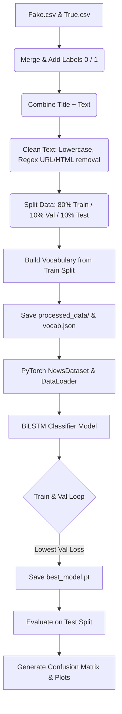

# Deep Learning NLP: Fake & True News Detection Pipeline

This project implements a modular, high-performance Deep Learning (NLP) pipeline in PyTorch to classify news articles as either **FAKE** or **TRUE**. The architecture is structured to facilitate clean data ingestion, robust preprocessing, custom neural classification modeling (using a Bidirectional LSTM with pooling heads), model evaluation with charts, and interactive CLI predictions.

---

## 📂 Project Structure

```
Deap_learning/
├── Fake.csv                   # Input raw dataset (Fake news articles)
├── True.csv                   # Input raw dataset (True news articles)
├── requirements.txt           # Python dependency requirements
├── train_pipeline.py          # Master wrapper to orchestrate the pipeline stages
├── README.md                  # Project documentation (this file)
├── venv/                      # Python virtual environment directory
├── tests/                     # Unit test scripts
│   └── test_pipeline.py       # Test script for testing pipeline functions
├── src/                       # Main Python source package
│   ├── __init__.py            # Package initializer
│   ├── config.py              # Configuration settings and model hyperparameters
│   ├── data_preprocessing.py  # Data loading, cleaning, shuffling, splitting & vocab creation
│   ├── dataset.py             # Custom PyTorch Dataset (NewsDataset) class
│   ├── model.py               # BiLSTM Classifier architecture
│   ├── train.py               # Training and validation epochs runner
│   ├── evaluate.py            # Test dataset evaluator and metrics generator
│   └── predict.py             # Inference predictor class & interactive CLI
├── processed_data/            # Auto-generated directory containing processed splits and vocab
│   ├── train.csv
│   ├── val.csv
│   ├── test.csv
│   └── vocab.json
├── saved_models/              # Auto-generated directory containing saved checkpoints
│   └── best_model.pt
└── plots/                     # Auto-generated directory containing training & evaluation plots
    ├── training_history.png   # Train/Val loss and accuracy curves
    ├── confusion_matrix.png   # Test set confusion matrix heatmap
    └── evaluation_report.txt  # Classification performance report
```

---

## ⚙️ NLP Pipeline Architecture



1. **Preprocessing & Tokenization**: Title and body text are merged to form a complete news representation. Text is converted to lowercase, stripped of HTML tags, URLs, special characters, and tokenized by word whitespace.
2. **Vocabulary Building**: A lookup table is built from the training set, mapping tokens to integers. Infrequent words are mapped to a generic `<unk>` token, and `<pad>` (index 0) is reserved for sequence alignment.
3. **PyTorch Dataset**: Converts text indices to standard tensors, padding or truncating up to `MAX_LEN=300`.
4. **BiLSTM Classifier**: Words map to high-dimensional vectors via an embedding layer. A 2-layer Bidirectional LSTM models text sequence dependencies. Outputs are summarized using joint **Global Average Pooling** and **Global Max Pooling**, fed into feed-forward fully-connected dense layers with ReLU and Dropout, and squashed to a binary classification logit.
5. **Training & Early Checkpoints**: Standard BCE loss with logits, optimized via Adam. Weights with the lowest validation loss are saved.
6. **Inference / CLI**: Processes arbitrary text strings, yields classification outcome (FAKE / TRUE) along with a percentage probability.

---

## 🚀 Getting Started

### 1. Install Dependencies
Ensure you have Python installed, then install requirements:
```bash
pip install -r requirements.txt
```

### 2. Run the End-to-End Pipeline
To run preprocessing, training, and evaluation in sequence, run the master script:
```bash
python train_pipeline.py
```

### 3. Run Pipeline Stages Individually (Optional)
If you wish to run only specific stages of the pipeline:
- **Preprocessing only**:
  ```bash
  python train_pipeline.py --preprocess
  ```
- **Training only**:
  ```bash
  python train_pipeline.py --train
  ```
- **Evaluation only**:
  ```bash
  python train_pipeline.py --evaluate
  ```

### 4. Run the Unit Tests
Verify the pipeline's logic (data cleaning, custom padding dataset loaders, and deep learning network shape bounds) without loading any CSV dataset files:
```bash
python -m unittest tests/test_pipeline.py
```

---

## 🔮 Predicting News Authenticity (Inference)

Once you have trained the model, you can run the interactive command line predictor. Paste any news article text, and get real-time evaluations:

```bash
python src/predict.py
```

**Example Output:**
```
============================================================
       FAKE VS TRUE NEWS DETECTION - PREDICTOR CLI
============================================================
Model loaded successfully. Ready for predictions.

Instructions: Paste your news article title & content, then press Enter.
Type 'exit' or 'quit' to terminate the session.

Enter News Article Text:
> FBI Russia probe helped by Australian diplomat tip-off. Trump campaign adviser George Papadopoulos told an Australian diplomat in May 2016 that Russia had political dirt on Democratic presidential candidate Hillary Clinton...

----------------------------------------
Classification Result: TRUE
Confidence Level:      99.87%
----------------------------------------
```

---

## 🛠️ Configuration & Hyperparameters

You can tune parameters easily in `src/config.py`:
- `MAX_LEN`: Adjusts sequence padding length (default: 300).
- `BATCH_SIZE`: Adjusts training batch size (default: 64).
- `LEARNING_RATE`: Adjusts learning rate for Adam optimizer (default: 0.001).
- `EPOCHS`: Set maximum training iterations (default: 10).
- `EMBEDDING_DIM`: Size of representation embedding layer (default: 100).
- `HIDDEN_DIM`: Number of units in LSTM hidden layers (default: 128).
- `NUM_LAYERS`: LSTM depth (default: 2).
- `DROPOUT`: Regularization dropout probability (default: 0.3).
